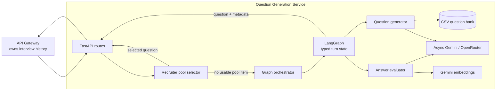
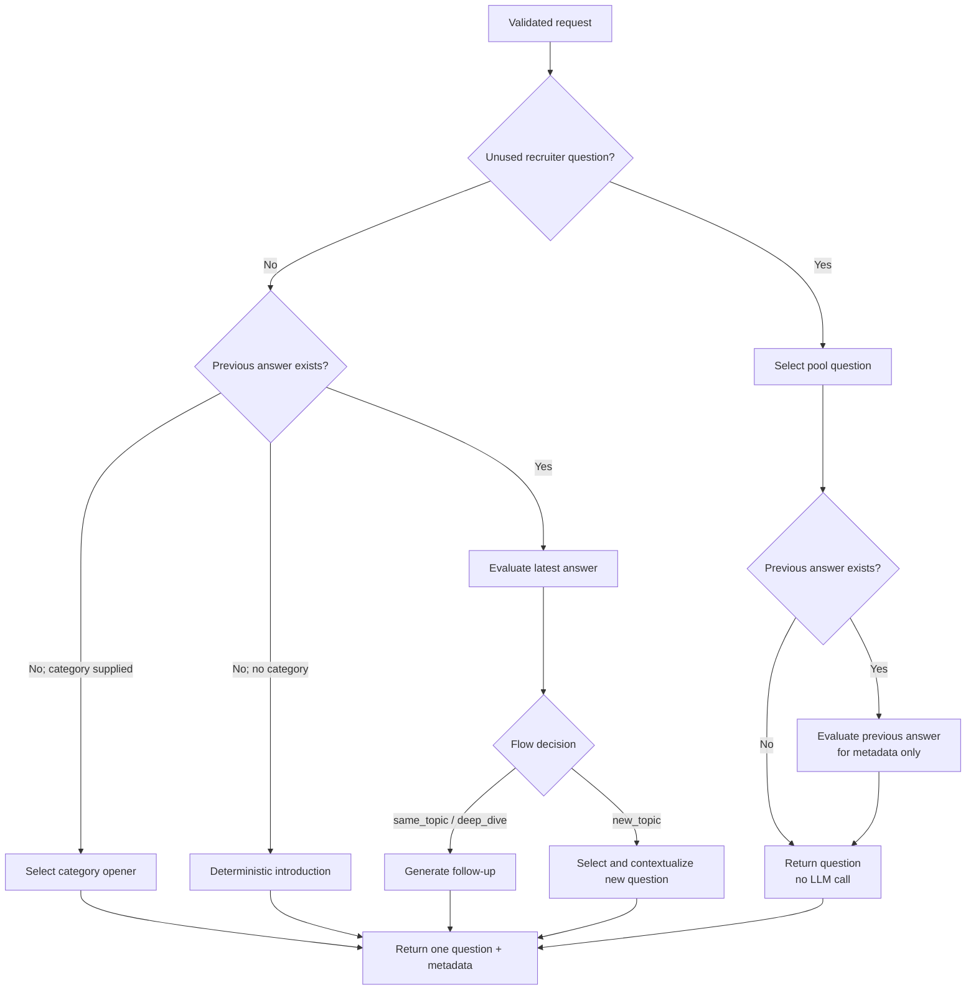
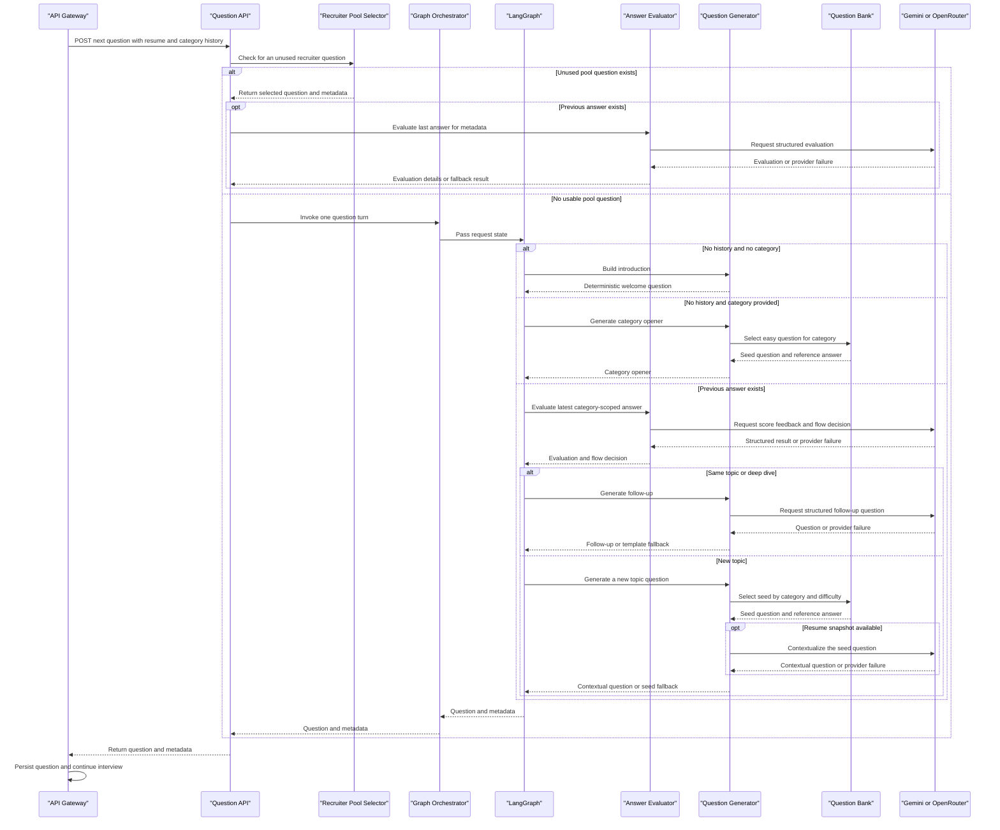

# Question Generation Service: Architecture and Interview Guide

## Purpose and scope

The Question Generation service turns interview context into one next-question response. It is called by the gateway, which owns the interview lifecycle, database persistence, and the decision about which category of interview question comes next.

This document describes the current implementation—not a proposed replacement. It explains the architecture, question and email flows, data handling, design choices, trade-offs, limitations, and likely interview questions with defensible answers.

## 1. Architecture at a glance



The same `app.main:app` ASGI entry point is used by the Docker image and the
Procfile/Nixpacks startup configuration. The service can also run its separate
interactive interview CLI through `app/cli.py`.

### Main runtime components

| Component | Responsibility | Why it is separate |
|---|---|---|
| FastAPI application (`app/main.py`) | Loads the question bank once at startup, creates shared clients/services, stores them on `app.state`, and includes the API router. | Keeps process composition and lifecycle out of request handlers. |
| API router (`app/api/routes.py`) | Implements `/next-question`, `/draft-email`, and `/health`; adapts HTTP request models to service calls. | HTTP behavior can be tested without invoking real providers. |
| Request schemas (`app/schemas/requests.py`) | Validates question, history, recruiter pool, and email request shapes. | Makes the external contract explicit and provides safe per-request defaults. |
| LLM schemas (`app/schemas/llm.py`) | Defines Pydantic outputs for a generated question, answer evaluation, and email draft. | A provider response is not trusted until it validates against the expected shape. |
| Question/evaluation services | Own selection, prompts, deterministic checks, fallback behavior, and scoring. | Keeps domain decisions independent of FastAPI and graph wiring. |
| LLM client (`app/services/llm_client.py`) | Makes asynchronous calls to Gemini and OpenRouter and validates structured output. | Centralizes provider configuration, timeout handling, fallback, and JSON validation. |
| LangGraph (`app/graph/`) | Selects which generation/evaluation operation runs for the current request. | Makes the turn-level flow and its branch conditions explicit. |
| Orchestrator (`app/pipelines/orchestrator.py`) | Converts service inputs into graph state, invokes the graph once, and returns the question/metadata pair. | Preserves a small facade between API code and graph implementation. |
| Gateway | Loads interview and resume state, scopes answer history to the current category, calls this service, and persists the result. | Keeps durable interview state with the system that owns interviews. |

## 2. End-to-end question-generation flow

### 2.1 Request entry and recruiter question pool

The gateway calls `POST /next-question` with a resume snapshot, optional
category and difficulty, previous question/answer pairs, and—when configured—a
recruiter-provided question pool and its used-question list.

The API route first considers the recruiter pool:

1. Remove questions whose exact question text is listed as already used.
2. If a category was requested, prefer unused questions whose topic matches it
   case-insensitively. With no requested category, any unused question is
   eligible.
3. Choose the first preferred question, or the first unused question if none
   matches the requested topic.
4. If there is no unused pool question, continue into the LangGraph flow.
5. If history exists for a selected pool question, evaluate the last answer to
   populate response metadata. A pool-selection response is still returned if
   that evaluation call fails; the failure is logged.

This path is deterministic and avoids generation calls for a usable pool
question. The API does not randomize recruiter-pool order; selection follows
the incoming list order.

### 2.2 Graph entry routing



When the pool path does not return a question, the orchestrator invokes the
compiled graph once with the request context. The initial edge selects one of
three paths:

| Request state | Graph path | Result |
|---|---|---|
| No previous answers and no category | Introduction node | Deterministic welcome/introduction question, optionally personalized with the resume name. |
| No previous answers and a category | Category-opener node | Dataset question for that category at easy difficulty; falls back to the full dataset if that category is absent. |
| Previous answers exist | Evaluation node | Evaluate the most recent answer, then route to a follow-up or a new question. |

The gateway currently builds history from questions in the same category. That
is intentional: the service receives a focused context window rather than the
candidate's entire interview transcript. With an answer in graph state,
`deep_dive` and `same_topic` decisions route to a follow-up; `new_topic` routes
to dataset-based new-question generation.

### 2.3 Question generation and fallback

For a new topic, the generator selects a seed question from
`data/software_questions.csv`, preferring the requested category and difficulty
and avoiding recently covered topics where history contains topic information.
If the category is unknown, the full dataset is considered. Selection
constraints are relaxed in stages when the eligible pool is small or empty.
Without a resume snapshot, the seed is returned as-is or with an optional
conversational prefix. With resume data, the service extracts a concise snapshot
and asks the LLM to contextualize the seed question.

For a follow-up, the service sends the previous question, candidate answer,
evaluation details, requested topic, and a concise resume snapshot to the LLM.
The structured output must contain a question. The generator strips common
preambles and keeps the first sentence; its follow-up check requires a
question mark, at least ten characters, no more than 30 words, and between one
and ten overlapping words of at least four characters from the previous
answer. If the LLM call fails or the follow-up fails these checks, a
topic-aware template is used.

The graph returns one question and metadata. It does not loop until it has
generated an interview-length set of questions: the gateway controls the
interview loop and calls this service again for each turn.

### 2.4 Candidate email drafting

`POST /draft-email` is a separate feature that uses the same canonical LLM
client but does not enter the question graph:

1. Validate the request with `DraftEmailRequest`. `scenario`, candidate name,
   and job title are required; optional context includes company, scheduled
   time, stage, scores, and recruiter instructions.
2. Select guidance for `shortlisted`, `interview_scheduled`, `stage_advance`,
   `rejection`, `offer`, or `custom`. An unknown scenario uses the custom
   guidance.
3. Build a prompt with the candidate's first name, role, company, provided
   interview context, and scenario-specific instructions. Rejection requests
   with category scores ask for a short performance summary.
4. Ask the shared LLM client for a `DraftEmail` structured response and reject
   an empty subject or body.
5. Return `{"subject": "...", "body": "..."}`. Failures become an HTTP 500
   response for the caller to handle.

The email path uses only request data and does not persist a draft or update
candidate/interview records.

## 3. Data flow and state ownership

### Request-to-response data path

```text
Candidate / Recruiter
        │ answer, settings, resume, optional question pool
        ▼
Gateway ── reads interview state and category-scoped Q/A from its database
        │ POST /next-question
        ▼
Question Generation API
        ├── recruiter pool available ──► deterministic selection
        │                                  └─► optional last-answer evaluation
        └── otherwise ──► orchestrator ──► LangGraph route
                                           ├─► introduction
                                           ├─► category opener
                                           └─► evaluate → follow-up/new topic
                                                  │
                         dataset CSV ◄────────────┤
                         Gemini / OpenRouter ◄───┤ when generation/evaluation needs LLM
                         Gemini embeddings ◄──────┤ heuristic evaluation with reference answer
                                                  ▼
                                  {question, metadata}
        ◄─────────────────────────────────────────┘
        │ persists question and continues interview orchestration
        ▼
Candidate sees the next question
```

### What data moves where

| Data | Source | Use inside this service | Owner after the response |
|---|---|---|---|
| Resume JSON | Gateway loads the candidate's parsed resume. | Introduction name lookup and a compact skills/projects/experience prompt context. | Gateway/database; this service does not persist it. |
| Previous Q/A | Gateway selects history for the current category. | Last answer evaluation and follow-up context; history can also inform topic avoidance if each item includes a `category` or `topic`. | Gateway/database. |
| Difficulty/category | Interview settings provided by the gateway. | Dataset filtering, prompt guidance, and category opener selection. | Gateway/database. |
| Recruiter question pool | Interview/job settings provided by the gateway. | Deterministic unused/topic-matched question selection before the graph. | Gateway/database; used items are supplied by the caller. |
| Question bank | Service-local CSV loaded at application startup. | Seed question selection and reference-answer lookup. | Versioned service data file. |
| LLM prompt and response | Built by the generation/evaluation/email code and sent to a configured provider. | Contextual question, follow-up, answer evaluation, or email content. | Not stored by this service. |
| Embeddings | Gemini embedding API, invoked by the evaluator's heuristic path when there is a reference answer. | Semantic component of a heuristic answer score. | Used in memory for that scoring operation. |
| Question and metadata | Produced by the pool path or graph. | Returned to the gateway. | Gateway persists the question and response metadata as appropriate. |

The service itself has no database repository or durable interview-session
store. `QuestionGraphState` is state for one graph invocation, not a persistent
conversation. The gateway is the source of truth for interview records,
category-scoped history, and used recruiter-pool questions.
Email context is also constructed in memory from the request, sent to the
provider, and returned as a draft; this service does not store it.

## 4. Evaluation and routing decisions

Answer evaluation returns two related values:

1. An evaluation result for feedback and score presentation: pass/fail,
   normalized depth score, confidence, feedback, answer length, and
   follow-up-needed status.
2. A flow result: `new_topic`, `same_topic`, or `deep_dive`, with a score and
   remarks used to decide the next graph node.

The evaluator avoids provider calls for several predictable cases:

- Empty or very short text (fewer than three characters) gets a minimal-answer
  result.
- Text recognized by the "I don't know" phrase matcher receives a direct
  unfamiliarity result and moves on.
- Answers shorter than five words receive a low score and are routed for
  follow-up.

Other answers use one structured LLM request for both scoring and flow
decision. A score of at least `0.55` is considered a pass. If structured
evaluation fails, the evaluator uses a heuristic:

- With a reference answer: `0.5 × semantic similarity + 0.3 × keyword overlap
  + 0.2 × answer-length score`.
- Without a reference answer: answer length is the heuristic score, capped at
  `1.0`.

The graph uses the flow decision—not only the pass flag—to route. This lets a
strong answer still receive a `deep_dive` follow-up when the evaluator decides
that a deeper probe is worthwhile.

## 5. LLM and embedding provider behavior

### Chat completions

`LLMClient` is the sole chat-completion implementation used by question
generation, answer evaluation, and email drafting.

1. If configured, Gemini is attempted first.
2. If Gemini fails or times out, OpenRouter is attempted when configured.
3. Each provider is attempted at most once per completion; this is provider
   fallback, not an unbounded retry loop.
4. Provider calls have a default 60-second timeout.
5. `complete_json` includes the Pydantic schema in the model instructions,
   extracts JSON (including a simple fenced-JSON form), and validates it with
   Pydantic. Invalid structured output raises an error to the caller.
6. Callers choose the appropriate failure strategy: question generation uses
   a fallback question, evaluation uses the heuristic path, while email
   drafting returns an HTTP error.

The client is asynchronous: Gemini uses the SDK's async API and OpenRouter
uses `httpx.AsyncClient`. The SDK receives a schema instruction in the prompt;
the current code does not configure Gemini's native constrained JSON response
mode.

Model configuration:

| Variable | Meaning |
|---|---|
| `GEMINI_API_KEY` | Enables Gemini chat and is required for Gemini embeddings. |
| `GEMINI_CHAT_MODEL` | Gemini chat model; defaults to `gemini-2.5-flash`. |
| `OPENROUTER_API_KEY` | Enables OpenRouter as fallback, or as the only chat provider. |
| `LLM_FALLBACK_MODEL` | OpenRouter fallback model when Gemini is configured; defaults to `meta-llama/llama-3.1-8b-instruct:free`. |
| `LLM_PRIMARY_MODEL` | OpenRouter model used when Gemini is not configured. |
| `APP_URL` | Optional OpenRouter referer metadata. |
| `EMBEDDING_MODEL` | Gemini embedding model; defaults to `gemini-embedding-001`. |
| `EMBEDDING_DIMS` | Embedding output dimension; defaults to `768`. |

The fallback model name is only used if a key for the relevant provider is
available. Secrets belong in environment/secret management, never in this
document or source control.

### Embeddings

`GeminiEmbedder.encode` is a synchronous adapter for the existing scoring
interface. It batches text inputs, requests normalized Gemini embeddings, and
retries an embedding batch up to three times with short backoff delays. When
semantic similarity is needed, the evaluator calls that synchronous work via
`asyncio.to_thread` so network I/O and retry sleeps do not directly block the
FastAPI event loop.

## 6. Design choices and rationale

| Choice | Rationale and defensible trade-off |
|---|---|
| Separate API, schemas, services, graph, and CLI pipelines | Each layer has one clear reason to change. HTTP contracts do not need to live beside prompt logic, and CLI conversation management is not confused with the API's stateless request handling. |
| Composition in `app/main.py` | A single startup path constructs shared clients and services, loads the dataset once per process, and wires the router. It is easy to test and keeps provider setup out of every request. |
| Store shared runtime objects on `app.state` | Routes get dependencies from the active FastAPI application instead of module-level mutable globals. This is compatible with multiple app instances in tests and makes process lifecycle ownership explicit. |
| Pydantic `Field(default_factory=list)` for answer history | Each request gets its own empty list rather than sharing a mutable model default between request instances. |
| LangGraph for one turn's branching | The service has explicit branch points—introduction, category opener, answer evaluation, follow-up, and new topic. A graph makes this routing inspectable and testable. It is not used as a substitute for the gateway's durable interview state. |
| No graph checkpoints or vector database | Current decisions need only request-supplied context and a local question bank. Checkpoint persistence or retrieval infrastructure would add operational and cost complexity without a demonstrated requirement. |
| One canonical async chat client | Consolidates provider selection, timeout behavior, fallback, and structured response validation; avoids blocking chat calls and inconsistent behavior across features. |
| Pydantic output models | Validate the shape and basic constraints of model output before the rest of the service consumes it. Schema validation does not prove the generated content is factually correct. |
| Deterministic pool selection before LLM flow | Recruiter-authored questions are authoritative and do not need generative rewriting. This reduces latency/cost and preserves recruiter wording. |
| Seed question bank plus optional personalization | The dataset provides a bounded topic/reference base; resume-aware rewriting adds relevance while a known seed and fallback preserve availability. |
| Deterministic short-answer paths | Very short and explicit unfamiliarity answers can be handled cheaply without spending a model call on an obvious case. |
| Combined score and flow LLM output | One model round trip produces feedback and a routing recommendation. This reduces latency/cost compared with asking separately, at the cost of making the output schema/prompt more important. |
| Heuristic evaluation fallback | Provider failure does not necessarily prevent the interview from progressing. The score is approximate and should not be treated as a calibrated hiring decision. |
| Gateway owns persistence | Interview records and cross-turn state remain with the service already responsible for interview data. This service stays replaceable and horizontally scalable without sticky session state. |
| Two Gunicorn workers in the container | Provides multiple worker processes for request handling. Each process has its own application lifespan, clients, dataset, and in-memory question-selection set; this is not shared state. |

## 7. Production caveats and practical improvements

These are observations about the current implementation, not claims that the
system already provides the safeguards:

1. **Question reuse state is process-local.** `QuestionGenerator` keeps
   `used_question_ids` on the shared service instance. It is not scoped to an
   interview, is not shared across Gunicorn workers, and resets on restart.
   This can influence dataset selection across unrelated candidates. Prefer
   making selection stateless per request using the gateway's already-used IDs
   or adding an explicit interview/session-scoped selection input.
2. **Question-history topic avoidance depends on optional fields.** The
   generator's topic extraction looks for `category` or `topic` in each history
   item. The gateway currently sends category-scoped records with `Q` and `A`
   only, so that particular recent-topic avoidance signal is absent on that
   call path. Category filtering still applies independently.
3. **Heuristic scores are approximate.** The semantic/keyword/length formula
   is a graceful fallback, not a validated measure of candidate quality. A
   production hiring decision should not depend on it without calibration,
   bias review, and human oversight.
4. **Embedding failures can look like neutral semantic evidence.** The
   similarity helper catches embedding errors and returns `0.5`; the heuristic
   then continues. A future version should report the degraded signal and
   distinguish "embedding unavailable" from actual measured similarity.
5. **Pool evaluation is best-effort.** The recruiter-pool route logs and
   suppresses an evaluation exception so question delivery succeeds. Consumers
   must treat the empty evaluation as unavailable, not as a successful score.
6. **Chat output validation is structural, not semantic.** Invalid JSON raises
   and is handled by feature-level fallbacks, but a valid Pydantic object may
   still contain a poor, repetitive, or unsupported question. Add content
   quality checks and observability if those properties become requirements.
7. **Provider fallback increases worst-case latency.** A timeout against
   Gemini can be followed by a separate OpenRouter attempt. Measure end-to-end
   request latency and choose a total request budget appropriate to the
   gateway's timeout.
8. **Embedding calls use a synchronous SDK in worker threads.** This protects
   the async event loop, but repeated failures can occupy worker threads during
   backoff. An async embedding client or bounded semaphore/circuit breaker is a
   possible later improvement.
9. **Health is a process check, not a dependency check.** `/health` returns
   service status and does not test LLM credentials, provider reachability, or
   embedding availability. Keep liveness cheap; add a separately secured and
   appropriately cached readiness/dependency check if operations need it.
10. **Resume content crosses a provider boundary.** The service extracts a
    compact subset for personalization, but it still contains candidate
    information. Production operation needs approved provider/data-retention
    settings, access controls, and a documented data-minimization policy.
11. **Service-level access control is not visible in these routes.** The
    frontend normally reaches the gateway, but deployment/network policy must
    ensure the microservice is not exposed as an unauthenticated public API.
12. **Per-worker startup matters.** With multiple Gunicorn workers, each process
    initializes its own clients and loads the CSV. Scale worker count with
    provider limits, memory, and startup cost in mind.

## 8. Interview questions and defensible answers

### Architecture and boundaries

**Q1. Why did you split this service into `api`, `schemas`, `services`,
`graph`, and `pipelines`?**

**A.** They represent different responsibilities: HTTP transport, input/output
contracts, domain/provider operations, turn routing, and the orchestration
facade/CLI flow. That lets me test the decision logic with mocked providers and
change HTTP wiring without rewriting prompts. I kept the structure modest:
there is no separate repository or domain layer because this service does not
own durable data.

**Q2. Why is `main.py` a composition root instead of putting initialization
inside the API module?**

**A.** Startup is where shared clients, the dataset, evaluator, generator, and
orchestrator are assembled. Keeping that wiring in one place makes lifecycle
and ownership explicit and lets the router depend on the app's initialized
state. It also avoids constructing an LLM client for every request.

**Q3. Why use `app.state` instead of module-level globals or constructing
services inside every route?**

**A.** The services are process-scoped dependencies, so FastAPI's application
state is a natural place to store them. It avoids module-global state leaking
between multiple application instances in tests and avoids repeated setup on
each request. I would still validate the service is initialized and consider
formal dependency providers if the dependency graph grows.

**Q4. Why use LangGraph for this flow?**

**A.** The flow has meaningful branching: introduction, category opener, then
evaluation followed by either a follow-up or a new topic. LangGraph makes
those states and transitions explicit and gives us a natural place to add
observable nodes later. The graph is intentionally one-turn and in-memory;
we do not claim that it persists conversations.

**Q5. Why not put the whole interview loop inside this service?**

**A.** The gateway owns interview records, scheduling/settings, category
scoping, question persistence, and downstream interview orchestration. This
service returns one question per call. Duplicating the loop here would create
two sources of truth and risk breaking gateway behavior.

**Q6. Why no checkpoint database, vector database, or multi-agent setup?**

**A.** The current graph uses request context plus a small local CSV question
bank. There is no demonstrated need for retrieval, durable graph resumption,
or independent agents. I would add those only after a measured requirement,
such as transcript lengths exceeding safe context limits or a need to resume
the graph independently of gateway state.

### Question flow and decisions

**Q7. What happens when a recruiter supplies a question pool?**

**A.** The service tries unused pool questions first, preferring the requested
topic. It returns the first eligible item, preserving recruiter-authored text
and avoiding generation cost. If no unused item remains, it falls through to
the normal graph. If previous answers exist, it also tries to evaluate the
last answer for metadata, but pool delivery is not blocked by evaluation
failure.

**Q8. How does the graph choose introduction versus category opener versus
answer evaluation?**

**A.** It checks the initial state. No history and no category means an
introduction; no history with a category means an easy category opener; any
history means evaluate the last answer. Tests cover introduction and follow-up
routing. The category-opener branch is simple enough to add a focused test if
we need more explicit coverage.

**Q9. When does it ask a follow-up?**

**A.** After evaluation, `same_topic` and `deep_dive` route to the follow-up
node. `new_topic` routes to a new dataset-based question. Separately, empty,
very short, and recognized "I don't know" responses have deterministic
evaluation behavior, so those do not all require an LLM request.

**Q10. How is a new question chosen?**

**A.** The service filters the dataset by category and difficulty when
possible, avoids recently used IDs while the instance has that state, and
relaxes constraints when too few questions remain. It then prefers topics
outside the last three covered when that information is present. The gateway's
current history format does not include topic fields, so that avoidance part
does not currently receive those topics on that path.

**Q11. What is the fallback if a follow-up LLM request fails or returns a
question that fails local checks?**

**A.** The generator uses a topic-aware template. For contextualizing a dataset
question, it falls back to the original seed (possibly with a conversational
prefix). The local follow-up check is a simple overlap/length heuristic, not a
semantic quality or safety evaluation. The API therefore has a non-LLM path
for delivering a question in those cases.

### Providers, async, and reliability

**Q12. How do you avoid blocking FastAPI's event loop?**

**A.** Chat uses the Gemini async SDK and `httpx.AsyncClient` for OpenRouter.
The embedding adapter is synchronous, so semantic similarity calls it via
`asyncio.to_thread`. That isolates blocking embedding work from the event loop.
The synchronous CLI is a separate execution path.

**Q13. Is the provider logic an automatic retry system?**

**A.** No. Each configured chat provider is attempted at most once: Gemini
first, then OpenRouter if available. This is bounded provider fallback. It
avoids infinite retry loops, but it can add up to two provider timeout windows
to a worst-case request, so the gateway timeout must be considered.

**Q14. What does “structured output” guarantee here?**

**A.** It asks the provider to return the Pydantic schema as JSON and validates
the returned JSON before using it. That guarantees the parsed object's
structure and field constraints, not correctness, relevance, fairness, or
factuality. Bad structured output raises and is handled by the calling
feature's fallback/error policy.

**Q15. Why keep an OpenRouter fallback if Gemini is primary?**

**A.** It provides a second configured provider path without changing the
service's client interface. The client chooses Gemini when available and
OpenRouter on failure; an OpenRouter-only deployment can use
`LLM_PRIMARY_MODEL`. This should be evaluated against latency, provider
availability, data policy, and cost rather than assumed to be universally
better.

**Q16. How does answer scoring work if the LLM is unavailable?**

**A.** Deterministic short-answer checks run first. For other answers, a
structured LLM result supplies score, confidence, feedback, and flow decision.
If that fails, a heuristic uses embeddings, keyword overlap, and length when
there is a reference answer, or length alone otherwise. It is a resilience
fallback, not a calibrated hiring assessment.

### State, scale, and operation

**Q17. Is the graph state the source of truth for an interview?**

**A.** No. It exists for one `ainvoke` call. The gateway retrieves category-
scoped history from its database, passes it in, and persists the generated
question. That gives the gateway durable state and lets the question service
remain horizontally replaceable.

**Q18. Is question usage state currently isolated per candidate or interview?**

**A.** Not completely. `used_question_ids` belongs to the shared
`QuestionGenerator` instance in each worker, so it is process-local and can
affect multiple interviews within that worker. Workers do not share it, and
restarts reset it. I would replace it with request/interview-scoped used IDs
from the gateway before relying on it for fairness or strict non-repetition.

**Q19. What changes when Gunicorn has multiple workers?**

**A.** Each worker is a separate process and runs its own FastAPI lifespan. It
loads its own question bank and creates its own provider/service instances and
question-ID set. This improves process-level request handling but does not
create shared memory or shared interview state.

**Q20. What does `/health` tell an operator?**

**A.** It confirms the process can answer the health route. It does not call
Gemini/OpenRouter or verify embeddings. Provider readiness should be monitored
separately so a dependency outage does not make liveness checks restart every
worker.

**Q21. What would you improve first for production?**

**A.** First remove process-global question-selection effects by passing
interview-scoped used IDs or making selection stateless. Then make heuristic
degradation observable, add explicit integration/contract checks for provider
timeouts and category opener behavior, set an end-to-end latency budget across
gateway and both providers, and verify network-level authentication and
provider data-retention policies.

**Q22. How would you test without paid API access?**

**A.** Mock `LLMClient.complete_json`, provider network calls, and the embedder.
Test the exact output shape, provider timeout/failure path, invalid structured
output, deterministic short-answer behavior, each graph branch, and the
gateway-facing response contract. The current service tests are mocked and do
not require live provider credentials.

**Q23. Why does email drafting use the same client but not the question graph?**

**A.** Email drafting shares provider fallback and structured output
validation, but its scenario guidance and output schema are independent of
interview turn routing. Reusing the client avoids duplicate provider code;
putting email generation in the question graph would couple unrelated
workflows.

**Q24. Does a valid structured email guarantee the email is safe to send?**

**A.** No. The schema guarantees a non-empty subject and body, while the prompt
asks the model not to invent facts. It does not independently verify claims,
policy compliance, or tone. A production send flow should review or validate
generated content and use the product's intended approval step.

## 9. Short interview summary

> The Question Generation service is a stateless, one-turn FastAPI microservice
> behind the gateway. It prefers recruiter-authored pool questions, otherwise
> routes the request through a small LangGraph: deterministic introduction or
> category opener when there is no answer history, and combined answer
> evaluation followed by a follow-up or new topic when history exists. A
> canonical asynchronous Gemini/OpenRouter client validates Pydantic-shaped
> outputs; deterministic checks, dataset questions, templates, and a heuristic
> evaluator provide bounded fallbacks. The gateway—not this graph—owns durable
> interview state. The main known production concern is that dataset question
> usage is currently tracked per worker rather than per interview.

## 10. Validation references

The service's mocked tests cover the LLM client, question generation, answer
evaluation, graph routing, and API response contracts. For a local check from
the repository root:

```powershell
D:\FYP_WORK\Start_prject\aicruit\.venv\Scripts\python.exe -m pytest services\question-generation\tests -q
```

The API's stable response shapes are:

- `POST /next-question` → `{"question": "...", "metadata": {...}}`
- `POST /draft-email` → `{"subject": "...", "body": "..."}`
- `GET /health` → `{"status": "ok", "service": "interview-question-generation"}`

<!-- mermaid-checked: every participant uses `participant Id as "Label"`, no \n in aliases/messages/notes, every alt/opt/loop closed by end, no `:` inside any alias -->

