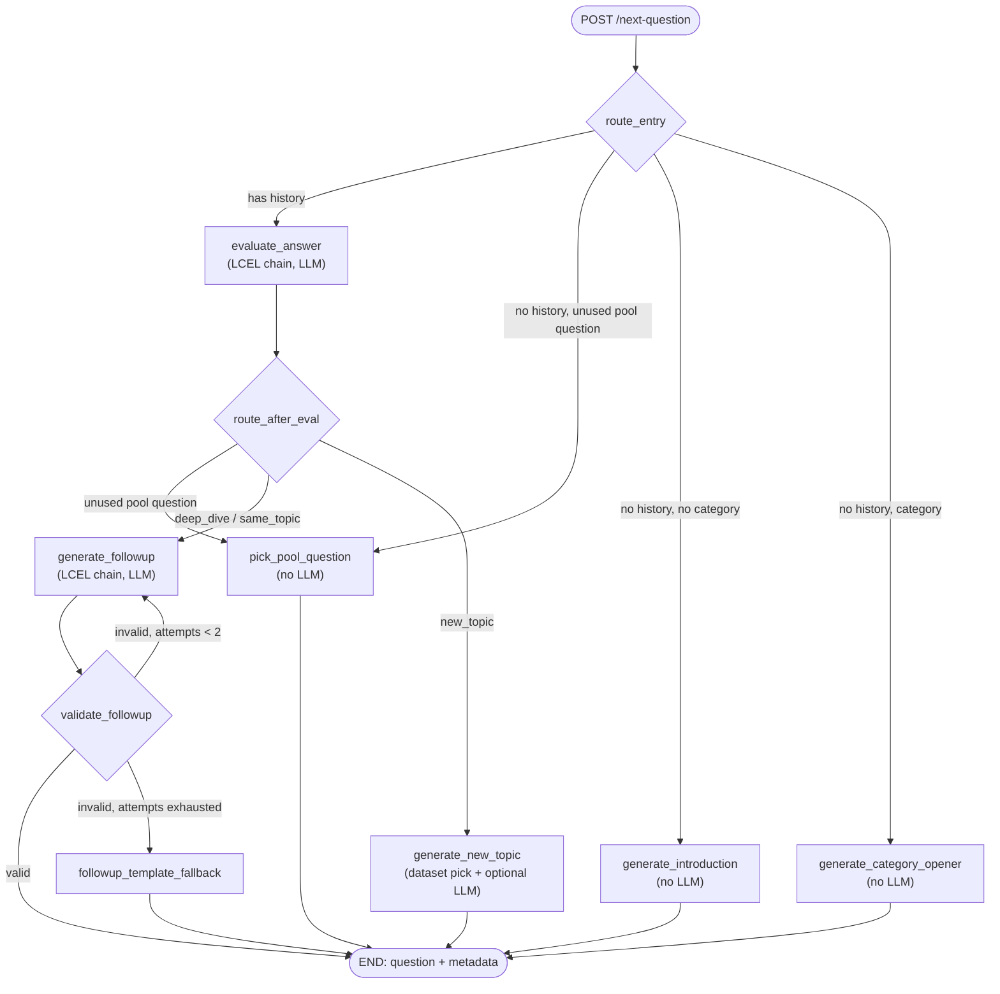
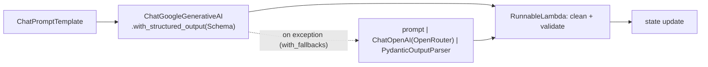

## ROLE AND GOAL

You are refactoring the FastAPI service in `services/question-generation` (monorepo `aicruit`) onto the LangChain ecosystem:
`ChatPromptTemplate`, LCEL chains (`prompt | model | parser`), structured output, `.with_fallbacks`, `RunnableBranch`/`RunnableLambda`, `ChatGoogleGenerativeAI`, `GoogleGenerativeAIEmbeddings` and LangGraph.

Keep the service's externally visible behaviour identical, then apply the improvements in section 7. Replace the hand-written provider plumbing (`app/services/llm_client.py`, `app/services/embedding.py`, string-built prompts, manual JSON parsing) with LangChain primitives.

Work in phases (section 9). Run `pytest -q` from `services/question-generation` after every phase and do not continue on red.

## 1. HARD CONSTRAINTS (do not break)

1. HTTP contract of `app/api/routes.py` stays the same:
   - `POST /next-question` takes `QuestionRequest` and returns `{"question": str, "metadata": {...}}`.
   - `POST /draft-email` takes `DraftEmailRequest` and returns `{"subject", "body"}`.
   - `GET /health` returns `{"status": "ok", "service": "interview-question-generation"}`.
2. The only caller is `gateway/app/routes/interview.py` (`_generate_question`). It sends `resume_json`, `previous_qa=[{"Q","A"}]` (same-category history only), `difficulty`, optional `category`, optional `question_pool` and `used_pool_questions`. Request fields may be ADDED only as optional with defaults. Response keys must never be removed or renamed.
3. Metadata keys that exist today must still be produced: `source, scenario, question_id, category, difficulty, reference_answer, is_followup, followup_angle, based_on_question, is_category_opener, evaluation{decision,score,confidence,remarks,feedback}`.
4. Env vars keep their meaning: `GEMINI_API_KEY`, `OPENROUTER_API_KEY`, `GEMINI_CHAT_MODEL` (default `gemini-2.5-flash`), `LLM_PRIMARY_MODEL`, `LLM_FALLBACK_MODEL` (default `meta-llama/llama-3.1-8b-instruct:free`), `EMBEDDING_MODEL` (default `gemini-embedding-001`), `EMBEDDING_DIMS` (default 768), `APP_URL` (OpenRouter referer). Update `.env.example` if you add any.
5. Provider policy stays: Gemini is primary when `GEMINI_API_KEY` is set, with a 60 s timeout and ONE attempt (no hidden retries). OpenRouter is the fallback, using `LLM_FALLBACK_MODEL` when Gemini is configured, or `LLM_PRIMARY_MODEL or LLM_FALLBACK_MODEL` when OpenRouter is the only provider. If neither key exists, startup fails with a clear `ValueError`. If every provider fails, raise an `LLMProviderError`-style exception.
6. Per-call generation settings stay: question generation `max_tokens=150, temperature=0.4`; evaluation `max_tokens=200, temperature=0.1`; email drafting `max_tokens=900, temperature=0.4`; Gemini `top_p=0.95`.
7. The service remains stateless per request. Do NOT add a LangGraph checkpointer or memory. The caller owns interview state. Compile the graph once at startup and reuse it.
8. Dockerfile, Procfile and nixpacks keep working (`gunicorn -k uvicorn.workers.UvicornWorker app.main:app`, Python 3.11).
9. Do not guess LangChain/LangGraph signatures. After installing, inspect the installed packages (`pip show`, `python -c "import inspect, ..."`, read the source) and confirm every parameter you use. Parameter names differ between versions, e.g. the max-tokens, retries and timeout kwargs on `ChatGoogleGenerativeAI` and `ChatOpenAI`, the embeddings dimensionality kwarg, and `StateGraph(input_schema=, output_schema=)` vs the older `input=`/`output=`.

## 2. CURRENT BEHAVIOUR (read these files first)

`app/graph/*` already uses LangGraph, but only as a router around service classes. All LLM work is hand-rolled.

Existing routing, which must be preserved:
- `route_initial_request`: no history and no category -> introduction; no history and category -> category opener; has history -> evaluate_answer.
- `route_evaluated_answer`: decision `deep_dive` or `same_topic` -> follow-up; anything else -> new_topic.
- `routes.py` has an extra recruiter-pool path BEFORE the graph. If `question_pool` has any question not in `used_pool_questions`, it picks `preferred[0]` (unused AND topic == category, case-insensitive, when a category is given) else `unused[0]` (topic mismatch is accepted on purpose), and returns it with `source="recruiter_pool"`. If there is history it still evaluates the last answer (`reference_answer=None`) and fills `metadata.evaluation`; an evaluator exception is swallowed and the question is still returned. With no history it makes ZERO LLM or evaluator calls (see `test_recruiter_pool_without_history_skips_llm_and_graph`). If the pool is exhausted, it falls through to the normal graph.

Evaluation (`AnswerEvaluator.evaluate_combined`), whose order must be preserved:
1. Answer shorter than 3 chars -> `score 0.1`, decision `same_topic`, no LLM.
2. "I don't know" regex `_DONT_KNOW_RE` (keep the regex verbatim) -> score 0.0, decision `new_topic`, `needs_followup=False`, no LLM.
3. Fewer than 5 words -> score 0.2, decision `same_topic`, no LLM.
4. Otherwise one LLM call returns `AnswerEvaluation` (score, confidence, feedback, decision in `new_topic|same_topic|deep_dive`, remarks, score_reason). Prompt inputs are truncated: question 300 chars, reference 300, answer 400. The reference line is included only when a reference exists and `is_followup` is false. `PASS_THRESHOLD=0.55`; `pass = score >= threshold`; `needs_followup = not pass`.
5. If the LLM fails: heuristic score = `0.5*semantic_similarity + 0.3*keyword_overlap + 0.2*min(1, words/20)` when a reference exists (the semantic part uses embeddings and returns 0.5 on any error), else `min(1, words/30)`. Decision is `new_topic` if passed else `same_topic`.
Return shape is `(evaluation_dict, flow_dict)` with the same keys as today (`pass, depth_score, confidence, feedback, answer_length, needs_followup` / `decision, remarks, score_value, score_reason`).

Question generation (`QuestionGenerator`):
- New topic: pick from the CSV `data/software_questions.csv` (columns `Id,Question,Answer,Category,Difficulty`, read with `encoding="latin1"`) using the progressive relaxation in `_pick_question` (category filter with full-dataset fallback; difficulty and unused; relax unused if <3; relax difficulty; last resort). Prefer rows whose Category is not among the last 3 `topics_covered`. If `resume_json` yields a non-empty snippet, personalise the seed question with the LLM, falling back to the raw question when the output is empty or longer than `word_limit + 25` words (limits easy 10, medium 15, hard 20). Otherwise use `_maybe_rephrase` (40% chance of a prefix).
- Category opener: always easy, no resume, `is_category_opener=True`.
- Introduction: templated greeting using `name` / `Name` / `personal_info.name`; no LLM.
- Follow-up: LLM generates one question, then `_clean_question` and `_is_valid_followup`; if invalid, use a random `_FALLBACK_TEMPLATES` entry. Angle map: `deep_dive` -> `implementation_details`, else `elaboration`.
- Keep `_build_resume_snippet` (skills, up to 3 projects, up to 3 experiences, 200-char descriptions).

`app/pipelines/flow_controller.py` and `conversation_manager.py` are used only by `app/cli.py`. Leave them untouched; only update `cli.py` imports and calls so the CLI still runs.

## 3. TARGET ARCHITECTURE



Every LLM node uses the same chain shape:



Rule: use an explicit LangGraph node only where there is real branching or a loop (entry, post-eval, follow-up validation). Everything else is an LCEL chain called inside a node.

## 4. FILE LAYOUT

```
app/
  config.py            # frozen dataclass Settings.from_env(); no module-level os.getenv elsewhere
  llm/
    models.py          # make_chat_models(settings) -> ChatModels; provider selection + fallback policy
    chains.py          # build_chains(models, settings) -> Chains dataclass of Runnables
    embeddings.py      # lazy GoogleGenerativeAIEmbeddings factory (may return None)
  prompts/
    templates.py       # every ChatPromptTemplate, with the existing prompt text preserved
  services/
    dataset.py         # DatasetRepository: load CSV, pick_question(..., exclude_ids) -> row (pure, no mutable state)
    evaluation.py      # regexes, constants, heuristics, short-circuit helpers (pure functions)
    text.py            # clean_question, is_valid_followup, build_resume_snippet
  graph/
    state.py           # QuestionGraphState (TypedDict) + any new keys
    nodes.py           # thin async nodes calling chains / services
    edges.py           # route_entry, route_after_eval, route_after_validation
    builder.py         # build_question_graph(deps) -> compiled graph
  schemas/             # keep requests.py and llm.py (see section 7 for optional additions)
  api/routes.py        # THIN: validate request -> graph.ainvoke -> response; email -> email chain
  main.py              # lifespan builds Settings, ChatModels, Chains, DatasetRepository, graph; stores on app.state
  pipelines/orchestrator.py  # keep InterviewOrchestrator.generate_next_question(...) as a thin facade over the compiled graph
```

Delete `llm_client.py`, `embedding.py`, `question_generator.py` and `answer_evaluator.py` once their logic has moved. Keep public names such as `InterviewOrchestrator` where tests and `cli.py` use them, or update those call sites.

## 5. LANGCHAIN SPECIFICS

Models (`llm/models.py`):
- Build `ChatGoogleGenerativeAI(model=settings.gemini_model, google_api_key=..., temperature=..., max_output_tokens=..., top_p=0.95, timeout=60, ...)` so that exactly one attempt is made. Check what the retries kwarg means in the installed version (the default is not 0 or 1 everywhere).
- For `gemini-2.5-*`, disable or cap thinking (e.g. `thinking_budget=0`) if the installed version supports it. Otherwise thinking tokens can consume `max_output_tokens=150` and return an empty question.
- OpenRouter: `ChatOpenAI(base_url="https://openrouter.ai/api/v1", api_key=..., model=..., default_headers={"HTTP-Referer": APP_URL}, timeout=60, no retries)`.
- Create separate model instances per generation profile (question, evaluation, email) via a small factory instead of relying on `.bind()` for temperature/max-token overrides, unless you verified `.bind()` works for that param.
- Gemini-only, OpenRouter-only and both-providers deployments must all work. With both: `primary_chain.with_fallbacks([fallback_chain])`.

Structured output (`llm/chains.py`):
- Primary: `prompt | gemini.with_structured_output(Schema)`.
- Fallback (free OpenRouter models often lack tool calling): `prompt.partial(format_instructions=parser.get_format_instructions()) | openrouter | PydanticOutputParser(pydantic_object=Schema)`. The parser tolerates ```json fences, replacing the manual fence stripping.
- Call `.with_fallbacks` on the finished chains, not on a bare model (`RunnableWithFallbacks` has no `with_structured_output`).
- Expose `Chains` as a dataclass of Runnables: `question`, `personalize`, `followup`, `evaluation`, `email`. Tests will inject `RunnableLambda` stubs instead of mocking HTTP.
- Add `.with_config(run_name=..., tags=["aicruit", ...])` to each chain. LangSmith tracing must be enabled purely by env vars, with no code branches. Never put resume content or candidate answers into run metadata or tags.

Prompt templates (`prompts/templates.py`):
- Use `ChatPromptTemplate.from_messages([("system", ...), ("human", ...)])`. Preserve the current wording, word limits and truncation (`[:300]`, `[:400]`) unless section 7 says otherwise.
- Brace safety. In f-string templates a literal `{` or `}` must be doubled. The email system prompt contains a literal `{Company} Hiring Team`, which must be escaped or passed as a variable or the chain will raise a missing-variable error. Never interpolate recruiter text, resume text or candidate answers into the template string itself; always pass them as template VARIABLES. Variable values are not re-parsed, so braces in them (e.g. the `{interview_link}` placeholder the email must contain literally) are safe. Keep the Python `.format()` that builds the scenario guidance and pass the result in as a variable.
- Drop the hand-written "Return JSON like {...}" blocks from prompts that go through structured output (the schema is supplied by LangChain).

Evaluation chain: build it as `RunnableBranch` over the three short-circuits (empty, don't-know, <5 words) with a default of `llm_eval_chain.with_fallbacks([RunnableLambda(heuristic_eval)])`. The heuristic fallback receives the same input dict. It must return the same `(evaluation, flow)` shape.

Embeddings (`llm/embeddings.py`): use `GoogleGenerativeAIEmbeddings` with `EMBEDDING_MODEL` and `EMBEDDING_DIMS` (verify the dimensionality kwarg name), called through `aembed_documents` (async, removing the current `asyncio.to_thread`). Embeddings are only needed by the heuristic fallback, so build them lazily and tolerate a missing `GEMINI_API_KEY`. In that case the heuristic drops the semantic term and renormalises the remaining weights.

## 6. LANGGRAPH SPECIFICS

State: keep the existing keys and add `pool: list`, `used_pool_questions: list`, `candidate: str`, `attempts: int`. Use `input_schema` / `output_schema` (or the installed version's equivalent) so the compiled graph only accepts request fields and only returns `question` and `metadata`.

Dependency injection: `build_question_graph(deps)` closes over a `Dependencies` dataclass (`chains`, `dataset`, `settings`, `rng`). Do NOT use module-level singletons. Take an injectable `random.Random` so tests can seed it.

Nodes (all `async def`, each returns a partial state update, never mutates the input state):
- `evaluate_answer`: runs `chains.evaluation`; stores `evaluation` and `flow`. Never raises. On an unexpected exception it logs and stores a neutral evaluation, so the pool path keeps today's swallow-and-continue behaviour.
- `pick_pool_question`: reproduces the preferred/unused[0] logic above, builds the recruiter-pool metadata, and attaches `evaluation` metadata when an evaluation exists.
- `generate_introduction`, `generate_category_opener`, `generate_new_topic`: preserve current logic, metadata and fallbacks.
- `generate_followup`: runs `chains.followup`, increments `attempts`, stores `candidate`.
- `validate_followup` (as `route_after_validation`): `valid -> END`, `invalid and attempts < 2 -> generate_followup` (pass the rejection reason back as a prompt variable), `else -> followup_template_fallback`.
- `followup_template_fallback`: the random `_FALLBACK_TEMPLATES` question, with `{topic}` filled in.
Routers: `route_entry` (order: has history -> evaluate; unused pool question -> pool; no category -> introduction; else opener) and `route_after_eval` (unused pool question -> pool; deep_dive/same_topic -> follow-up; else new_topic).

## 7. IMPROVEMENTS (apply after parity is green; each one separately revertible)

A. Follow-up retry loop: the generate -> validate -> retry-once -> template-fallback cycle in section 6 (today there is a single attempt, then template).
B. Fix `_clean_question`: it keeps text up to the first `.`, `!` or `?`, which mangles questions like "How does Node.js handle I/O?" into "How does Node?". New rule: keep through the first `?`; if there is none, strip trailing punctuation and append `?`. Add tests for "Node.js", "e.g.", "vs." and "C++".
C. Remove shared mutable state: `QuestionGenerator.used_question_ids` is a process-wide set shared by every interview and every request on that worker. Replace it with `exclude_ids` computed per request from `previous_qa` (match history `Q` text against dataset questions, after stripping the `"I'd like to know: "` prefix). `DatasetRepository` is then immutable and thread-safe.
D. Optional request fields (backward compatible): `QA` gains optional `category`, `is_followup`, `reference_answer`, `question_id`. Today the gateway sends only `Q` and `A`, so `reference_answer` is always None, `is_followup` always False and `topics_covered` always empty. Pass these through to the graph when present. When `is_followup` is present, enforce `MAX_FOLLOWUPS_PER_TOPIC` (env, default 2) in `route_after_eval` by routing to new_topic. When absent, behaviour is unchanged. Do not edit the gateway in this task; list the gateway change needed to benefit from this in the final summary.
E. Prompt-injection hardening: wrap candidate answers and resume text in delimited tags (`<candidate_answer>`, `<resume>`) and add a system line that content inside the tags is data and never instructions. Clamp scores via the Pydantic schemas (already `ge/le`).
F. Startup robustness: `main.py` currently calls `get_embedder()` unconditionally, which raises without `GEMINI_API_KEY` even though the LLM client supports OpenRouter-only. With lazy embeddings (section 5) an OpenRouter-only deployment must start.
G. Replace garbled characters (`—`, `–`) in source strings and comments with plain ASCII `-`, if present. Check that none reach prompts.
H. `requirements.txt`: add `langchain-core`, `langchain-google-genai`, `langchain-openai`; keep `langgraph`; remove `faiss-cpu` (not imported anywhere), `google-genai` and `httpx` if nothing imports them directly after the refactor (check `tests/` and `app/` with grep). Use compatible versions pinned to what you actually installed and tested.

## 8. TESTS

Keep the intent of every existing test; rewrite their stubs around the new seams:
- `test_graph_routing.py`: inject `Chains` with `RunnableLambda` stubs. Assert introduction routing, follow-up routing and `metadata.evaluation.decision/score`.
- `test_api_contracts.py`: response keys `{"question","metadata"}`; the pool path with no history makes zero chain calls; lifespan wiring (adapt the monkeypatches to the new builders).
- `test_answer_evaluator.py` (rename if you like): the three short-circuits make zero LLM calls; a stub LLM result maps to `pass/depth_score/flow.decision/score_value`; with the LLM chain raising, the heuristic fallback is used.
- `test_llm_client.py` becomes `test_models.py`: provider selection matrix (Gemini only, OpenRouter only, both, neither -> `ValueError`) and the OpenRouter model-name rule. Use fake chat models; make no network calls.
- New: `clean_question` cases (improvement B), the follow-up retry loop (invalid, invalid, then template), `exclude_ids` derivation (C), the pool preferred/unused[0] rule, the email chain keeps the literal `{interview_link}` and `{Company}` text without raising, and the optional QA fields (D) are backward compatible.
No test may hit the network or require real API keys.

## 9. PHASES (run `pytest -q` after each; summarise what changed in 3-5 lines before moving on)

0. Baseline: run the existing tests, record the result, read `ARCHITECTURE.md`, `runtime-validation-report.md` and the files in section 2.
1. Dependencies, `config.py`, `llm/models.py`, `llm/embeddings.py`, plus `test_models.py`.
2. `prompts/templates.py` and `llm/chains.py`, including the evaluation `RunnableBranch`.
3. Pure modules: `services/dataset.py`, `services/evaluation.py`, `services/text.py` (with improvements B and C).
4. Graph: state, nodes, edges, builder; move the pool logic out of `routes.py`; add the follow-up retry loop (A).
5. Slim `routes.py`, rewire `main.py`, keep the `InterviewOrchestrator` facade, update `cli.py`, delete the old modules.
6. Tests per section 8. Then improvements D, E, F, G, H.
7. Final pass: update `ARCHITECTURE.md` (replace the provider and flow sections with the two diagrams above), `.env.example`, and `runtime-validation-report.md` if it describes removed components.

## 10. ACCEPTANCE CRITERIA

- `pytest -q` is green with no network access.
- `uvicorn app.main:app` starts with only `GEMINI_API_KEY`, with only `OPENROUTER_API_KEY`, and with both. It fails fast with neither.
- Manual checks, using stub or real keys:
  1. `POST /next-question` with an empty body returns the welcome question (`scenario="1st_question"`).
  2. With `category` and no history it returns an easy dataset question with `is_category_opener=true`.
  3. With history it returns a follow-up or a new-topic question whose `metadata.evaluation` is filled.
  4. With a `question_pool` and no history it returns the pool question with zero LLM calls.
  5. `POST /draft-email` for each scenario (shortlisted, interview_scheduled, stage_advance, rejection with `category_scores`, offer, custom) returns a subject and a plain-text body, and `interview_scheduled` keeps the literal `{interview_link}`.
- No module imports `httpx`, `google.genai` or `faiss`.
- No module-level mutable state is shared across requests.
- Final summary lists: files added, files deleted, deviations from this prompt with reasons, the optional gateway change for improvement D, and anything you could not verify.
