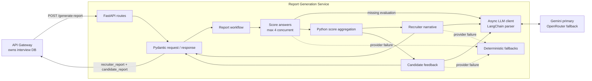
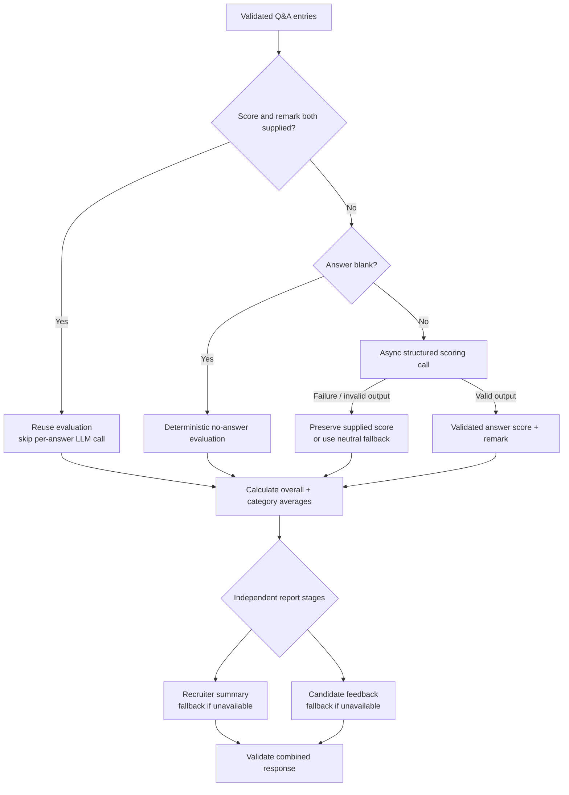

# Report Generation Service: Architecture and Interview Guide

## Purpose and scope

The Report Generation service converts interview question-and-answer data into two compatible views of the same interview:

- A recruiter report with an overall score, per-category scores, and a concise evidence-based summary.
- A candidate report with strengths and actionable improvement suggestions.

The gateway calls this service after the interview is complete. The report service does not own interview state or persist reports; the gateway remains responsible for database writes and interview lifecycle decisions. This document describes the implementation currently in the repository.

## 1. Architecture at a glance



### Runtime components

| Component | Responsibility |
|---|---|
| `app/main.py` | Creates the FastAPI application and includes the API router. It is the stable `app.main:app` ASGI entry point used by deployment configuration. |
| `app/api/routes.py` | Defines `/generate-report` and `/health`; validates requests through Pydantic, injects the LLM client, and translates unexpected generation errors to HTTP 500. |
| `app/schemas/reports.py` | Defines request, internal evaluation, structured LLM-output, and response schemas and field constraints. |
| `app/services/report_service.py` | Orchestrates scoring and builds the recruiter and candidate reports. |
| `app/services/scoring.py` | Reuses supplied evaluations, calls the LLM for missing evaluations, applies deterministic fallbacks, and calculates aggregate scores. |
| `app/services/recruiter_report.py` | Calculates recruiter-facing score fields and generates a validated narrative summary. |
| `app/services/candidate_report.py` | Generates validated candidate feedback and provides a deterministic fallback. |
| `app/llm/client.py` | Formats LangChain prompts, calls configured providers asynchronously, validates structured output, and applies bounded timeout/retry/fallback behavior. |
| `app/llm/dependencies.py` | Provides one cached LLM client per worker process through FastAPI dependency injection. |
| `app/prompts/report_prompts.py` | Holds the score, recruiter-summary, and candidate-feedback prompt templates. |
| `app/utils/scores.py` | Contains small deterministic score scaling and clamping helpers. |

The service deliberately uses ordinary async Python functions rather than LangGraph. The pipeline has one scoring stage followed by two independent report-generation calls. `asyncio.gather` expresses that fan-out directly without introducing graph state, persistence, or routing machinery.

## 2. End-to-end report-generation flow

### 2.1 Request entry and contract validation

The gateway posts a JSON body to `POST /generate-report`:

```json
{
  "data": [
    {
      "q": "How would you design a cache?",
      "a": "I would measure access patterns and define invalidation.",
      "category": "Systems",
      "ai_score": 4,
      "remarks": "Discussed eviction and invalidation."
    }
  ]
}
```

`ai_score` and `remarks` are optional. `ai_score`, when present, must be in the 1–5 range. Question/category strings are stripped and cannot be blank; answers and remarks are stripped when provided. `data` must contain at least one entry. Invalid request data is rejected by FastAPI/Pydantic with HTTP 422 before report generation starts.

The endpoint retains the established response shape:

```json
{
  "recruiter_report": {
    "overall_score": 8.0,
    "category_scores": [{"category": "Systems", "score": 8.0}],
    "overall_remark": "..."
  },
  "candidate_report": {
    "strengths": ["..."],
    "improvements": ["..."]
  }
}
```

Both success objects are validated against Pydantic response models before serialization.

### 2.2 Score each answer

The service processes each `QuestionEntry` in input order:

1. If both a score and a nonblank remark are supplied, it keeps that evaluation and skips an LLM request.
2. If the answer is blank, it avoids an LLM request and assigns score 1/5 (or retains an explicitly supplied score), along with a deterministic remark.
3. Otherwise, it asks the LLM to evaluate the answer against the question and any existing evaluation data.
4. The output must match `ScoreResult`: an integer score from 1–5 and a nonblank remark of at most 250 characters.
5. Any provider, timeout, or structured-output failure is caught for that entry. The service retains a supplied score if available; otherwise it uses the neutral fallback 3/5. It returns a clear deterministic fallback remark.

Scoring requests are concurrent but bounded by a semaphore to at most four in-flight scoring calls. `asyncio.gather` returns the results in the same order as the input list.

### 2.3 Calculate scores deterministically

Scores supplied to and returned from the API follow the established 1–5 input evaluation scale, while report scores are expressed on a 0–10 scale. `scale_to_ten` converts 1–5 values to 2–10; it does not map a score of 1 to zero. `clamp` protects the internal 0–10 range.

The service computes:

- **Overall score:** arithmetic mean of all normalized question scores, rounded to one decimal place.
- **Category score:** arithmetic mean of normalized scores for entries in that category, rounded to one decimal place.

The LLM never calculates or changes these aggregates. Supplied score and remark pairs are reused, while an incomplete supplied evaluation is completed: a supplied score is preserved and the LLM is asked for the missing remark.

### 2.4 Build both reports



Once entries are scored, `report_service.py` starts the recruiter-summary and candidate-feedback stages concurrently with `asyncio.gather`.

- The recruiter stage computes the overall and category scores in Python, then asks the LLM only for a narrative summary. If the LLM call fails or returns invalid output, a score-band-based deterministic remark is used.
- The candidate stage asks for evidence-based strengths and improvements. Its schema requires one to three nonblank items in each list. If generation or validation fails, deterministic templates are selected from the scored evidence, with general fallback messages where there are no qualifying entries.

This produces a complete response even when report-narrative generation is unavailable. Failures during individual LLM operations are handled in the relevant stage; unexpected errors escaping the workflow are logged by the route and returned as a generic HTTP 500 response.

## 3. Data flow and ownership

### Request-to-response path

```text
Gateway
  │ POST /generate-report { data: QuestionEntry[] }
  ▼
FastAPI route ── Pydantic request validation
  │ injected cached LLMClient
  ▼
Report workflow
  ├─ Score or reuse each answer (bounded concurrency)
  ├─ Calculate overall/category scores in Python
  └─ In parallel:
       ├─ Recruiter narrative → validated RecruiterSummary
       └─ Candidate feedback → validated CandidateReport
  ▼
Pydantic ReportResponse → JSON
  │
  ▼
Gateway persists/uses report fields
```

### Data and persistence boundaries

- The request contains question text, answer text, category, and optional existing evaluation fields.
- The service's internal `ScoredEntry` adds a normalized score and a resolved remark.
- The API response contains only recruiter and candidate report objects. Internal prompt values and per-question score records are not returned as a separate response field.
- This service does not access PostgreSQL or write report rows. The gateway owns persistence and consumes `recruiter_report` and `candidate_report`.
- The service forwards question/answer evidence to the configured external LLM provider when evaluation or narrative generation is needed. Fully evaluated answers and blank answers can avoid individual scoring calls, but recruiter/candidate narratives are still generated through the LLM when providers work.

## 4. LLM and provider behavior

### Provider selection and fallback

The canonical client uses Gemini as the primary provider when `GEMINI_API_KEY` is configured, and OpenRouter as a fallback when `OPENROUTER_API_KEY` is configured. If both are available, a failure from Gemini—including malformed structured output—allows the client to try OpenRouter. If no provider is configured, it raises `LLMProviderError`, which the report stages handle with their defined fallbacks.

Configuration read by the client:

| Variable | Use |
|---|---|
| `GEMINI_API_KEY` | Enables Gemini. |
| `GEMINI_CHAT_MODEL` | Optional Gemini model override. |
| `LLM_PRIMARY_MODEL` | Gemini model setting used when `GEMINI_CHAT_MODEL` is absent. |
| `OPENROUTER_API_KEY` | Enables OpenRouter fallback. |
| `LLM_FALLBACK_MODEL` | OpenRouter model override. |
| `LLM_TIMEOUT_SECONDS` | Per-provider-call timeout; default is 20 seconds. |
| `APP_URL` | OpenRouter HTTP referer metadata; defaults to localhost. |

The client loads a service-local `.env` if present. Deployment should provide secrets via its secret/environment mechanism rather than relying on a committed secret file.

### Structured output, retries, and async behavior

Prompts are `ChatPromptTemplate` instances. For each operation, `PydanticOutputParser` supplies format instructions and parses the model response into the operation's Pydantic schema. Invalid JSON or schema-invalid content is treated as a provider failure, not accepted as a report.

Provider calls use asynchronous APIs (`google-genai` async generation and `httpx.AsyncClient`). `asyncio.wait_for` bounds each call with the configured timeout. The client allows at most one retry, and retries only transient timeout/transport failures and HTTP 429/5xx responses. It does not retry ordinary malformed output indefinitely. After the primary provider's bounded attempts fail, it can try the configured fallback provider.

## 5. Design decisions and rationale

| Decision | Rationale |
|---|---|
| Keep the established routes, request fields, and response keys | The gateway already calls this endpoint and persists/uses these named report sections. Preserving the contract avoids coordinated client and database changes. |
| Keep LLM access behind one async client | Centralizes provider configuration, timeouts, retries, fallback, and schema parsing. It also avoids blocking FastAPI's event loop with synchronous provider calls. |
| Use Pydantic schemas for inputs and model outputs | Validates both client-supplied data and untrusted model output at boundaries. |
| Keep calculations deterministic | Means, scaling, and category grouping are auditable and reproducible; a language model is not trusted to perform arithmetic. |
| Preserve complete supplied evaluations | Avoids unnecessary provider cost and prevents re-scoring data already evaluated upstream. |
| Bound concurrent scoring | Allows latency savings across independent answers while limiting simultaneous external requests and resource use. |
| Generate the two audience narratives concurrently | Both depend on the same scored entries but neither depends on the other's output. |
| Provide explicit narrative/evaluation fallbacks | A temporary provider outage should not erase deterministic score information or prevent a structurally valid report response. |
| Do not add LangGraph | The current workflow is a short linear stage followed by a two-way fan-out/join. Direct async functions are simpler to test and operate; no graph-specific routing, checkpointing, or state persistence is required. |
| Keep persistence in the gateway | The gateway already owns the interview and report database contract; this service remains a focused transformation API. |

## 6. Reliability, constraints, and production considerations

- **Bounded provider work:** each provider call has a timeout; retries are capped; score fan-out has a concurrency limit.
- **Partial data:** blank answers and partial supplied evaluations have defined handling. No-answer inputs do not require an LLM score call.
- **Invalid model output:** structured parsing rejects it and triggers provider fallback or deterministic report-stage fallback.
- **API errors:** schema-invalid requests return 422. Unhandled workflow errors are logged and returned as generic 500 responses.
- **Privacy and retention:** prompt inputs include interview questions and candidate answers. Provider data handling, retention, and consent must be reviewed for the deployment's requirements. Avoid logging candidate text or secrets.
- **Prompt-injection boundary:** answers are untrusted content included in model prompts. The prompts direct models to use only the supplied evidence, but this is not a security boundary; downstream output is schema-validated and should not be treated as executable instructions.
- **No provider integration in unit tests:** tests mock structured LLM responses so normal test runs do not require credentials or incur API charges.
- **Operational monitoring:** production deployments should monitor latency, provider errors/fallback rates, timeout counts, and deterministic fallback usage without recording sensitive answer text.
- **Current scoring convention:** a 1–5 score maps to 2–10 on report output. This follows current behavior; changing to a 0–10 mapping would be a contract/behavior change requiring explicit approval and updated tests.
- **Worker lifecycle:** the cached client is per Python process. Each Gunicorn worker owns its own client instance and configuration; this is not a cross-worker shared object.

## 7. Test coverage

The service tests use mocked LLM implementations and exercise:

- Successful report generation and the unchanged API response shape.
- Request validation and the health endpoint.
- Pydantic output constraints.
- Deterministic overall and category calculations.
- Existing evaluation reuse and avoiding an unnecessary per-answer LLM call.
- Missing answers and missing evaluation data.
- Malformed structured output, timeout handling, bounded retry behavior, provider fallback, and no-provider failures.
- Recruiter and candidate fallback responses when providers fail.

Run from the repository root:

```powershell
.\.venv\Scripts\python.exe -m pytest services\report-generation\tests -q
```

Tests demonstrate the mocked application path, not live provider connectivity or production deployment behavior.

## 8. Interview questions and defensible answers

### Architecture and boundaries

**Q: What problem does this service solve, and what does it own?**  
A: It turns interview Q&A plus optional existing scores into recruiter and candidate reports. It owns evaluation, aggregation, and narrative generation. The gateway owns interview state and database persistence.

**Q: Why is this service not writing directly to the database?**  
A: The gateway already owns the interview/report persistence contract. Keeping this service stateless avoids duplicating database ownership and lets it focus on a request-to-response transformation.

**Q: Why was the code separated into API, schemas, services, prompts, and LLM packages?**  
A: These are distinct responsibilities: HTTP handling, data contracts, business orchestration/calculation, prompt text, and provider integration. The separation makes changes and tests more focused without introducing a large framework.

**Q: Why is there no LangGraph workflow?**  
A: There is no meaningful conditional graph routing or persistent graph state. Scoring is followed by two independent report calls, which `asyncio.gather` models clearly. A graph would add concepts and dependencies without solving a current orchestration problem.

### Scoring and report quality

**Q: Which fields are generated by an LLM, and which are calculated in code?**  
A: The LLM may score an individual answer and write qualitative summaries/feedback. Python normalizes scores and computes overall and per-category averages. Numerical aggregation is deterministic and testable.

**Q: How do you avoid calling the LLM unnecessarily?**  
A: If both the input score and remark are present, the evaluation is reused. A blank answer gets deterministic no-answer handling. Missing portions of a partial evaluation are completed as needed.

**Q: What happens if an answer has an existing score but no remark?**  
A: The service asks the LLM to supply a remark while the deterministic scoring logic preserves the supplied score.

**Q: How is a provider outage handled?**  
A: The client tries configured providers with a bounded timeout and at most one retry for transient failures. If scoring still fails, it preserves any supplied score or uses a neutral fallback. Recruiter and candidate narrative stages also have deterministic fallbacks.

**Q: Why not let the LLM produce the final overall score?**  
A: The overall score is an arithmetic mean of normalized per-question scores. Calculating it in Python removes arithmetic variance and makes the result reproducible.

**Q: What is the score conversion rule?**  
A: Input/LLM scores are 1–5. They are multiplied by two, rounded to one decimal place, and bounded to the 0–10 internal range; therefore 1/5 becomes 2/10 and 5/5 becomes 10/10.

### Providers, async, and reliability

**Q: How do you ensure model responses fit the response contract?**  
A: `PydanticOutputParser` parses generated text into typed Pydantic models with constraints. Invalid or malformed output fails that provider attempt and can trigger configured provider fallback.

**Q: How does the implementation avoid blocking FastAPI's event loop?**  
A: Both provider integrations use async I/O, the workflow functions are async, and parallel work is awaited rather than delegated through synchronous LLM wrappers.

**Q: What is the retry policy?**  
A: A provider call is bounded by `LLM_TIMEOUT_SECONDS` (20 seconds by default). At most one retry is allowed, and only for timeout/transport exceptions or 429/5xx responses. Structured parse failures do not loop indefinitely.

**Q: Why limit parallel scoring to four calls?**  
A: Answer scoring is independent and can run concurrently, but unbounded fan-out could overload providers or increase rate-limit failures. The semaphore caps in-flight scoring requests.

**Q: What should be considered when handling candidate answers?**  
A: They are personal interview data and are sent to whichever external LLM provider is configured. Deployment needs appropriate consent, provider-retention review, secret management, and careful logging. Schema validation limits output shape but does not make model behavior inherently safe.

### Testing and operation

**Q: How do tests run without API credentials?**  
A: Tests inject stub clients that return known Pydantic results or raise controlled errors. This verifies behavior deterministically without paid external calls.

**Q: What do the unit tests not prove?**  
A: They do not establish real credentials/provider availability, provider policy compliance, deployed network access, database persistence, or end-to-end gateway-to-report deployment behavior.

**Q: How would you extend this design if workflows became more complex?**  
A: First define the new stages, state, and branch conditions. A workflow graph becomes justified if multiple conditional routes, resumability, or explicit graph state materially improve clarity. Until then, keep the direct async orchestration.

## 9. Short interview summary

“The report service is a stateless FastAPI transformation API. It validates interview Q&A, reuses complete upstream evaluations, asynchronously fills missing evaluations with a schema-validated LLM client, and calculates numeric aggregates deterministically. It then generates recruiter and candidate narratives concurrently, with bounded provider retries/timeouts and deterministic fallbacks. The gateway remains the persistence owner. We use direct async orchestration rather than LangGraph because the current workflow is linear with a simple independent fan-out.”

## 10. Source references

- Application composition and HTTP contracts: `app/main.py`, `app/api/routes.py`
- Request/response and model-output schemas: `app/schemas/reports.py`
- Main orchestration and scoring: `app/services/report_service.py`, `app/services/scoring.py`
- Audience-specific reports: `app/services/recruiter_report.py`, `app/services/candidate_report.py`
- Provider client and lifecycle: `app/llm/client.py`, `app/llm/dependencies.py`
- Prompt templates and score helpers: `app/prompts/report_prompts.py`, `app/utils/scores.py`
- Mocked tests: `tests/test_api.py`, `tests/test_llm_client.py`, `tests/test_report_generation.py`
- Gateway call and persistence integration: `gateway/app/routes/interview.py`
