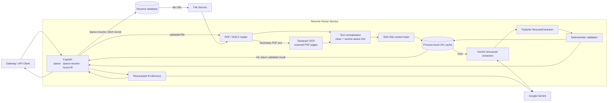
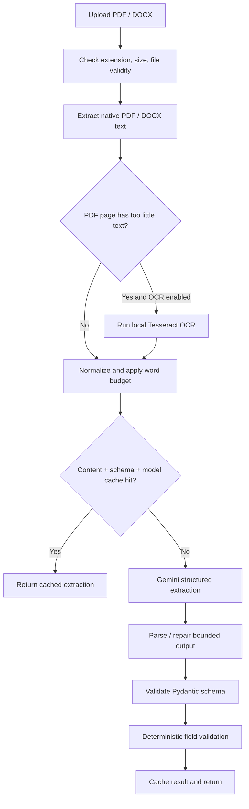
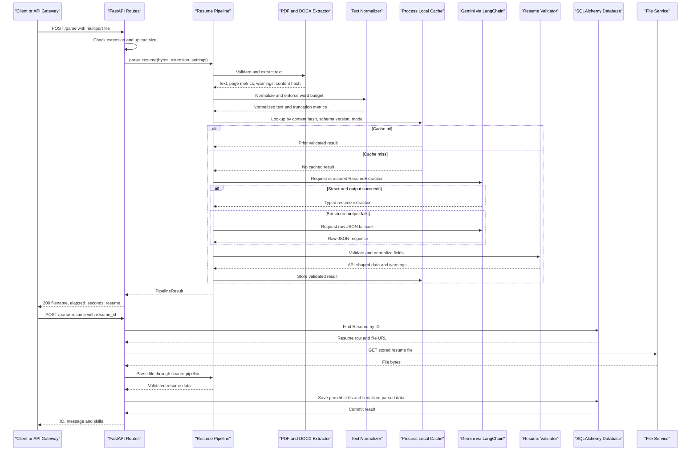

# Resume Parser Service: Architecture and Interview Guide

This document explains the current implementation of `services/resume-parser`: its runtime architecture, API contracts, parsing and scoring flows, external dependencies, design trade-offs, known limitations, and interview preparation notes. It describes the code as it exists today, including caveats that are useful to know rather than implying the service has capabilities it does not yet implement.

## 1. What the service does

The Resume Parser is a Python 3.11 FastAPI service that accepts PDF or DOCX resumes, extracts and normalizes their text, asks Google Gemini to turn that text into a typed resume structure, and applies deterministic cleanup before returning the result. It also exposes an existing resume-versus-job scoring endpoint and a database-backed operation for parsing a resume already stored by the application.

The service is independently deployable. The frontend normally reaches the platform through the API gateway; the gateway or other backend code can call the Resume Parser over HTTP. The API itself contains no authentication dependency or role-checking middleware.

## 2. Architecture at a glance



### Main code areas

| Area | Responsibility |
|---|---|
| `app/api.py` | FastAPI application, HTTP routes, request handling, response/error mapping |
| `app/core/config.py` | Pydantic Settings and environment-backed service configuration |
| `app/services/pdf_extractor.py` | PDF/DOCX validation and text extraction; conditional Tesseract OCR for short/empty PDF pages |
| `app/services/text_normalizer.py` | Control-character/artifact cleanup, repeated-header heuristic, section-aware word-budget truncation |
| `app/services/resume_extractor.py` | Gemini chat model construction, structured extraction, raw JSON fallback, retry and concurrency controls |
| `app/services/resume_validator.py` | Deterministic normalization and validation of extracted fields |
| `app/services/resume_pipeline.py` | Orchestrates extraction through caching and validation; translates lower-level errors |
| `app/schemas/resume.py` | Pydantic extraction, request and response models |
| `app/prompts.py` | Resume-extraction and score-fit prompts |
| `app/inference.py` | Direct Google GenAI SDK call used by `/score-fit` |
| `app/db.py` | SQLAlchemy engine, `Resume` ORM model, session helper and table creation |

## 3. Technology choices and rationale

| Choice | Why it fits this service | What it trades off |
|---|---|---|
| FastAPI | Async route support, request parsing, OpenAPI generation and a straightforward `TestClient` | The parser still has synchronous work (PDF extraction, database calls and the SDK call); async endpoints alone do not make every operation non-blocking |
| PyMuPDF | Fast native PDF text extraction and page rendering without an external PDF process | PDF reading is synchronous; OCR still needs an external Tesseract binary |
| Tesseract OCR | Local fallback for image/scanned PDF pages instead of sending page images to a vision API | OCR needs language/system packages and can be slower or less accurate than selectable PDF text |
| `python-docx` | Reads DOCX paragraphs directly from bytes | The current extraction reads paragraphs only; it does not reproduce full Word layout or pagination |
| Pydantic models | A typed, reusable schema for structured LLM output and stable API serialization | A valid shape does not prove the facts are correct; semantic accuracy still needs evaluation |
| LangChain `ChatGoogleGenerativeAI` structured output | Maps Gemini output to `ResumeExtraction` and centralizes model configuration | Framework abstractions add dependencies; provider changes still require compatibility testing |
| Raw JSON fallback | Retains a recovery route if schema-bound invocation fails | It creates a second provider call on the fallback path and may still produce malformed or semantically wrong data |
| Tenacity retry with exponential jitter | Retries likely transient provider failures and spreads retry timing | Retries add latency and provider load; the current retry count is fixed in the decorator rather than using the configured retry setting |
| `asyncio.Semaphore` | Bounds simultaneous LLM operations within a worker process | The semaphore is process-local; multiple Gunicorn workers each have their own limit |
| In-memory LRU cache | Avoids repeated Gemini calls for identical bytes/model/schema version in the same process | It is not shared across workers or restarts and currently has no expiry/TTL |
| SQLAlchemy | Provides a small ORM integration for loading/updating resume records | The current endpoint uses synchronous DB access from an async route; production needs a reachable DB at application import/startup |
| Gunicorn + Uvicorn worker | Runs the ASGI app under a production process manager | Worker count and timeout must be tuned to deployment memory, provider latency and expected traffic |

## 4. Resume parsing pipeline



`POST /parse` and the unparsed path of `POST /parse-resume` converge on `parse_resume(data, ext, settings)`.

1. **Accept and gate the file.** The upload route permits `.pdf` and `.docx` extensions and applies the configured upload-size limit. The pipeline dispatches by extension. PDF bytes must begin with `%PDF-`; the PDF page count is checked against configuration.
2. **Extract text.** PyMuPDF reads PDF page text. Pages with fewer than the configured minimum characters are treated as potentially scanned: if OCR is enabled, Tesseract is checked and may OCR the page. DOCX input is read from an in-memory byte stream using `python-docx`; paragraphs are joined with newlines.
3. **Record extraction metadata.** PDF extraction returns page-level method (`native`, `ocr`, or `empty`), page counts, warnings and a SHA-256 hash of the original bytes. DOCX is treated as one native page for metrics.
4. **Reject unusable text.** A document with no extracted text becomes an `ExtractionFailedError`. If every insufficient-text PDF page needs OCR but Tesseract is unavailable, the extractor raises an explicit OCR-unavailable error that the pipeline maps to extraction failure.
5. **Normalize the text.** The normalizer removes selected control characters, page-marker strings and 15+-digit runs; attempts repeated header/footer removal; normalizes whitespace; and, if necessary, truncates to the configured word budget using section priorities.
6. **Check the cache.** The key includes the original content hash, schema version and Gemini model. A hit returns the prior validated result and marks it `cached=True`.
7. **Call Gemini.** The extractor builds `ChatGoogleGenerativeAI` from the model settings and API key, invokes `.with_structured_output(ResumeExtraction)` first, and falls back to a raw model invocation plus JSON parsing if structured output fails. Calls are executed in a thread executor while an async semaphore is held.
8. **Validate deterministically.** Pydantic constructs typed extraction entries; the validator cleans strings and email values, checks phone digit length, attempts URL normalization for `www.` values, splits descriptions into bullet lists, filters invalid list entries and emits warnings/corrections.
9. **Return and cache.** The API returns the normalized resume object. The pipeline records elapsed time, extraction/validation warnings and page/word metrics internally; `/parse` returns only filename, elapsed seconds and resume data.

### Pipeline error mapping

| Condition | Pipeline exception | Typical HTTP response from `/parse` |
|---|---|---|
| Unsupported extension, bad PDF header, excessive PDF size/page count | `FileValidationError` | 400 |
| Empty/unreadable text or OCR needed but unavailable | `ExtractionFailedError` | 422 |
| Provider authentication/configuration error or extraction/provider failure | `LLMFailedError` | 502 |
| Other pipeline exception | `PipelineError` | Its `status_code` (default 500) |
| Upload larger than route limit | Raised in API before pipeline | 413 |

## 5. Data flow by route

### `POST /parse` — direct upload

```text
Client
  -> multipart/form-data file
FastAPI upload route
  -> extension and size checks
  -> read file bytes in memory
Pipeline
  -> extraction -> normalization -> cache -> Gemini -> validation
FastAPI
  <- { filename, elapsed_seconds, resume }
```

Example:

```http
POST /parse
Content-Type: multipart/form-data

file=@candidate.pdf
```

Successful responses include a `resume` object with `personal_info`, `skills`, `experience`, `education`, `projects`, `certifications`, `publications`, `interests` and `languages`. Error responses use FastAPI's `detail` convention.

This route does not persist the result to the database. Repeating an identical upload may use the process-local pipeline cache.

### `POST /parse-resume` — parse a stored resume

```text
Caller sends { "resume_id": "..." }
  -> SQLAlchemy queries Resume
  -> if parsed_skills exists: return skills without downloading or parsing
  -> otherwise resolve stored file_url
  -> HTTP GET to file service (30-second request timeout)
  -> infer .docx from URL suffix; otherwise assume .pdf
  -> shared parse pipeline
  -> persist parsed_skills and serialized parsed data
  -> return { id, message, skills }
```

Request model: `ParseResumeByIdRequest`. Response model: `ParseResumeByIdResponse`. A missing row returns 404; file-service download errors return 502; pipeline errors map to 400, 422, 502 or the pipeline status; persistence failure returns 500.

### `POST /score-fit` — score a resume against a job

Request model: `ScoreFitRequest` with `resume` and `job` JSON objects. The handler serializes both into a prompt and calls `run_score_inference` using the Google GenAI SDK directly (not the LangChain resume-extraction pipeline). It expects `overall`, `skills_match`, `experience_match`, `education_match`, `project_match` and `rationale`; numeric scores are coerced to integers and clamped to 0–100. Invalid/provider results return 502 (`scoring_unavailable`). Response model: `ScoreFitResponse`.

The score prompt recommends a weighted overall score: 45% skills, 30% experience, 10% education and 15% projects. This is LLM-produced scoring, not a deterministic algorithm or calibrated hiring decision.

### Health and root endpoints

| Method and path | Current behavior |
|---|---|
| `GET /health` | Liveness-style response: `{"status":"ok"}` |
| `GET /readiness` | Returns 200 `{"status":"ready"}` when a Gemini key is configured, otherwise 503 with an issues list. It does not make a provider request or verify database connectivity. |
| `GET /` | Returns `{"message":"Go to the /docs"}` |

The FastAPI application also exposes the framework's OpenAPI/docs routes (normally `/openapi.json`, `/docs` and `/redoc`).

## 6. API inventory

| Method | Path | Input | Success result | Main failures |
|---|---|---|---|---|
| `POST` | `/parse` | Multipart file upload: PDF or DOCX | Filename, elapsed seconds and structured resume | 400 unsupported/invalid file; 413 upload too large; 422 no usable text; 502 LLM failure |
| `POST` | `/parse-resume` | JSON `ParseResumeByIdRequest` | `ParseResumeByIdResponse` containing ID, message and skills | 404 missing resume; 502 download/provider failure; 400/422 invalid or unextractable file; 500 unexpected/persistence error |
| `POST` | `/score-fit` | JSON `ScoreFitRequest` | `ScoreFitResponse` with four sub-scores, overall and rationale | 422 request-schema failure; 502 scoring/provider or invalid response |
| `GET` | `/health` | None | `{"status":"ok"}` | Normally none |
| `GET` | `/readiness` | None | Ready JSON or not-ready issue list | 503 if Gemini API key is not configured |
| `GET` | `/` | None | Documentation hint | Normally none |

No API version prefix is currently used.

## 7. Schema and persistence boundaries

- **`ResumeExtraction`** is the internal LLM output schema. Nested Pydantic models represent personal information, experience, education, projects and related lists. `to_api_dict()` serializes this structure into the established API response shape.
- **`ParseResumeByIdRequest` / `ParseResumeByIdResponse`** define the database-backed parsing route's request and response.
- **`ScoreFitRequest` / `ScoreFitResponse`** define the score-fit JSON contract.
- **`Resume` SQLAlchemy model** represents an existing stored resume row used by `/parse-resume`. That route writes `parsed_skills` and serialized `parsed_text`. `POST /parse` itself does not write to this table.
- The pipeline's **`PipelineResult`** carries data plus internal metrics/warnings. Most of those metrics are not exposed by the public upload route.

The database URL and SQLAlchemy engine are configured in `app/db.py`. `init_db()` is called while `app.api` is imported and invokes `Base.metadata.create_all`; this is convenient for the small service but couples module import/startup to DB availability and is not a replacement for managed schema migrations.

## 8. LLM, resilience and concurrency behavior

### Resume extraction

- Provider: Google Gemini through `langchain-google-genai`.
- Default model: `gemini-2.5-flash`.
- Structured output schema: `ResumeExtraction`.
- Fallback: invoke the same model without structured output and parse raw JSON. The parser also strips basic Markdown JSON fences and can salvage a JSON object from surrounding text.
- Retry: Tenacity retries only errors classified as `TransientLLMError`; the decorator allows three total attempts with exponential jitter. Errors recognized as authentication/model configuration problems are classified permanent.
- Concurrency: one lazily initialized `asyncio.Semaphore` limits LLM calls within the worker process.
- Validation: deterministic cleanup follows the LLM; validation is not a second Gemini call.

### Score-fit

`/score-fit` uses `google-genai` directly and asks for JSON mode. It does not share the resume-extraction semaphore, retry wrapper, cache or Pydantic extraction schema. The API checks and clamps the returned scores.

### Be precise about resilience claims

There is no circuit breaker, distributed rate limiter, shared cache, durable job queue or asynchronous job-status API. The retry mechanism is not a circuit breaker. The configured `llm_max_retries` and `processing_timeout_seconds` settings should not be assumed to govern the current implementation without tracing usage: retry attempts are specified in the Tenacity decorator, and the parsing flow does not currently wrap the whole operation in the processing-timeout setting.

## 9. Deployment and runtime

| Deployment file | Runtime behavior |
|---|---|
| `Dockerfile` | Python 3.11 slim image; installs Tesseract; installs requirements; runs `gunicorn app.api:app` with two Uvicorn workers, 300-second timeout and port 8006 by default (overridden by `PORT`) |
| `nixpacks.toml` | Installs Python 3.11 and Tesseract, installs `requirements.txt`, starts Gunicorn with two Uvicorn workers on `$PORT` |
| `Procfile` | Starts Gunicorn with two Uvicorn workers and a 300-second timeout on `$PORT` |

The `nixpacks.toml` start command currently does not specify `--timeout 300`, unlike Docker and the Procfile. Align it if deployments require long-running LLM calls to have the same worker timeout in every environment.

Important runtime dependencies include PyMuPDF, `python-docx`, pytesseract, Pillow, Pydantic/Pydantic Settings, LangChain Google GenAI/core, Google GenAI, Tenacity, FastAPI/Uvicorn/Gunicorn, SQLAlchemy, psycopg2, requests and python-multipart. Tesseract itself is an operating-system package, not a Python package.

For local development, install the service requirements and run:

```powershell
python -m uvicorn app.api:app --reload --port 8006
```

The API reads provider/database/service settings from environment variables and the service `.env` file. Provide secrets through the deployment's secret manager or runtime environment; do not bake keys into the image.

## 10. Security, privacy and operational considerations

- Resume text and personal information are sent to the configured Gemini provider for extraction and to Google GenAI for score-fit. Apply the organization's consent, retention and provider data-processing requirements before production use.
- API routes shown here do not authenticate or authorize callers. Restrict service ingress or add authenticated service-to-service authorization before exposing it publicly.
- The API accepts complete uploads into memory. Apply reverse-proxy upload limits and consider streaming/temporary storage if file sizes or concurrency grow.
- `/parse-resume` makes an outbound request to `file_url` stored in the database. Restrict/validate allowed file-service hosts to reduce SSRF risk if that URL can be influenced by untrusted input.
- The parser logs operational metrics without intentionally logging full resume text. Provider exception strings are logged in some paths; review provider errors for accidental sensitive content.
- `/readiness` checks only configuration presence, not Gemini reachability, DB reachability or downstream service health. Treat it as a lightweight configuration gate rather than a full dependency health check.
- Existing DB setup creates tables during import. Prefer controlled migrations and explicit startup lifecycle handling for production.
- The in-memory cache key hashes file bytes and includes model/schema version, but the cache is worker-local and retains parsed personal data in process memory until eviction/restart.

## 11. Known limitations and honest trade-offs

1. **Extraction quality is probabilistic.** Correct JSON shape does not guarantee exact facts. Always evaluate extraction against representative labeled resumes and measure field-level precision/recall.
2. **Text layout can be lost.** PDF text extraction may reorder columns, merge words or emit broken glyphs; DOCX tables and headers/footers are not fully represented by the current paragraph-only reader.
3. **OCR quality depends on system setup and scan quality.** Tesseract availability is checked lazily, and OCR language/rotation/image-quality handling is basic.
4. **Header/footer removal is heuristic.** It splits on blank-line groups and removes repeated exact first/last lines in three or more chunks; false removals are possible.
5. **Truncation is word-based, not token-count-based.** Section detection is English-heading oriented, and low remaining word budgets may omit content. Inspect truncation metrics for long resumes.
6. **The cache is process-local.** With two Gunicorn workers, a cache hit on one worker does not imply a hit on another; restarts clear all cached results.
7. **The concurrency limiter is process-local.** With two workers configured, up to the configured number of calls can run in each worker, not across the whole deployment.
8. **Some model settings are not wired to behavior.** `llm_max_retries` and `processing_timeout_seconds` exist in Settings but the current call path uses decorator retries and does not apply an overall pipeline deadline.
9. **URL normalization is partial.** The validator prepends `https://` for `www.` values, but a bare `linkedin.com/...` or `github.com/...` value is warned as malformed and retained.
10. **`/parse-resume` returns skills only.** It saves the whole parsed object as serialized text, but its response contract includes only ID, message and skills.

## 12. Interview questions: “Why this and not that?”

### Architecture and parsing

**Q: Why split the parser into extractor, normalizer, LLM extractor, validator and pipeline modules instead of keeping everything in one route?**  
A: Each module owns one stage and has a narrow input/output contract. PDF, text-cleaning, provider and validation logic can be tested or replaced independently; the pipeline coordinates error mapping and metrics. The route stays focused on HTTP behavior.

**Q: Why extract PDF text locally before calling Gemini instead of sending the whole PDF to a multimodal model?**  
A: Local text extraction is cheaper, makes the prompt input explicit, and allows deterministic file checks and cleanup. It also avoids transmitting page images. The trade-off is that text extraction loses visual layout and OCR may be weaker than vision-based interpretation.

**Q: Why use PyMuPDF rather than pdfplumber?**  
A: The current service uses PyMuPDF for native text and rendering pages for conditional OCR in one library. It is a practical fast path. A different parser could be selected if evaluation shows materially better table, column or reading-order accuracy.

**Q: Why OCR only pages with little native text rather than OCR every page?**  
A: Native text is usually faster and more faithful for text-based PDFs; OCR is reserved for scanned or image-heavy pages to reduce latency and avoid OCR noise. The threshold is heuristic and should be tuned on representative documents.

**Q: Why use a deterministic validator after the LLM?**  
A: Formatting and simple invariants such as email cleanup, phone digit counts and bullet splitting do not need a probabilistic call. This keeps the model focused on semantic extraction and makes cleanup reproducible. It cannot prove that a name or employment fact is true.

### LLM and data contracts

**Q: Why structured output with a raw JSON fallback?**  
A: Structured output constrains the provider response to a Pydantic schema and reduces parsing ambiguity. Raw JSON fallback preserves compatibility if schema-bound invocation fails. The fallback is still model output and must be validated; a provider outage should not be hidden as successful extraction.

**Q: Why Pydantic rather than manually parsing dictionaries?**  
A: Pydantic centralizes defaults, field types, validation and serialization. It provides a stable contract for the API and easier tests. For stronger contract guarantees, the schema can be made stricter and unknown fields can be handled explicitly.

**Q: Why is output not considered correct just because it validates?**  
A: Schema validation verifies shape and types, not whether the LLM accurately copied details from the source. Semantic evaluation needs ground-truth annotations, field-level metrics and human review for ambiguous resumes.

**Q: Why use Gemini Flash?**  
A: A Flash model is intended to offer lower latency/cost for structured extraction than a larger reasoning model while being capable enough for common resumes. The choice should be confirmed using accuracy, latency and cost benchmarks on the target resume population; it is configurable by model name.

### Performance and reliability

**Q: Why use a semaphore if the route is already async?**  
A: Async request handling permits overlap while awaiting provider work. The semaphore caps concurrent provider calls to protect quotas and reduce overload. It is per process today, so a deployment-wide limit needs a shared limiter or provider-side quota control.

**Q: Why use retries with jitter, and why not retry every error?**  
A: Temporary rate limits, timeouts and server errors may recover; exponential jitter avoids synchronized retry storms. Authentication and invalid-model failures are not transient, so retrying them wastes time. Error classification by message markers is imperfect and should ideally use provider exception types/status codes.

**Q: Why an in-memory cache instead of Redis or the database?**  
A: An LRU cache is simple and low-latency for a small single-instance service. It avoids persistent storage of another copy of personal data. The trade-off is worker/process locality, no TTL and repeated work across replicas; Redis is appropriate if shared cache behavior becomes necessary and privacy/retention rules allow it.

**Q: Why use a thread executor for the Gemini call?**  
A: The LangChain invocation is synchronous. Running it in an executor prevents that blocking call from occupying the async event-loop thread. A fully async provider client could remove the thread handoff if supported reliably.

### API and persistence

**Q: Why have both `/parse` and `/parse-resume`?**  
A: `/parse` handles an uploaded file and returns the parsed object without database persistence. `/parse-resume` is an integration path for a resume already stored by ID: it fetches the record/file, parses if needed, persists the result and returns skills.

**Q: Why is `/score-fit` separate from parsing?**  
A: It is a distinct operation with a distinct input/output contract: it compares already-structured resume data with a job. Keeping the route separate preserves backward compatibility and allows scoring to evolve independently. It currently uses the Google SDK directly rather than the extraction service abstraction.

**Q: Why return different amounts of data from the two parsing routes?**  
A: `/parse` is an interactive upload API and returns the full extraction; `/parse-resume` currently satisfies a narrower caller contract that needs skills and a success message. If consumers need the complete parsed record, version or extend that response contract deliberately.

**Q: Why use SQLAlchemy and still call `create_all`?**  
A: SQLAlchemy provides the ORM mapping and sessions for the existing resume record. `create_all` simplifies initial development/bootstrap, but production schema evolution should use explicit migrations; creating tables during module import also makes startup sensitive to DB connectivity.

### Security and production readiness

**Q: Is this API safe to expose publicly as-is?**  
A: No. The route code shown has no authentication or authorization checks. It should be reachable only through a trusted boundary or be extended with authenticated service-to-service access, authorization, rate limits and upload controls.

**Q: What personal data leaves the service?**  
A: For uncached parses, extracted resume text is sent to Gemini; score-fit sends the resume and job JSON to Google GenAI. The deployment must meet consent, privacy, retention and vendor data-processing requirements.

**Q: What does readiness guarantee?**  
A: Only that a Gemini API key is configured. It does not test an actual Gemini call, DB access, file-service access, or OCR. A production readiness endpoint should check the dependencies required for that instance to serve its intended traffic without making expensive calls on every probe.

**Q: What would you improve next?**  
A: Add labeled extraction evaluations; improve PDF column/layout and DOCX table handling; tune OCR/normalization from observed failures; make provider exceptions typed; wire real end-to-end deadlines and settings; share rate limits/cache if needed; move schema changes to migrations; secure service-to-service access; and add robust observability without logging resume content.

## 13. Service communication sequence

<!-- mermaid-checked: every participant uses `participant Id as "Label"`, no \n in aliases/messages/notes, every alt/opt/loop closed by end, no `:` inside any alias -->


## 14. Quick interview summary

> “This is a FastAPI resume-processing service. It validates and extracts text from PDF or DOCX locally, conditionally OCRs low-text PDF pages, normalizes and truncates the text, checks a process-local content cache, and uses Gemini structured output to populate a Pydantic resume schema. A deterministic validator cleans common fields before the result is returned. A separate route can retrieve a stored resume from the file service and persist its parsed data; another route uses Gemini to score an already-parsed resume against a job. The design separates I/O and transformation stages, but current production caveats include missing API-level authentication, process-local limits/cache, import-time DB table creation, and extraction accuracy that still needs labeled evaluation.”

## 15. Source map

- API routes: `app/api.py`
- Settings: `app/core/config.py`
- Extraction schema: `app/schemas/resume.py`
- PDF/DOCX handling and OCR: `app/services/pdf_extractor.py`
- Normalization and truncation: `app/services/text_normalizer.py`
- Gemini extraction and retry: `app/services/resume_extractor.py`
- Deterministic validation: `app/services/resume_validator.py`
- Pipeline and cache: `app/services/resume_pipeline.py`
- Prompt definitions: `app/prompts.py`
- Score-fit provider call: `app/inference.py`
- Database model and session: `app/db.py`
- Runtime/deployment: `Dockerfile`, `nixpacks.toml`, `Procfile`
